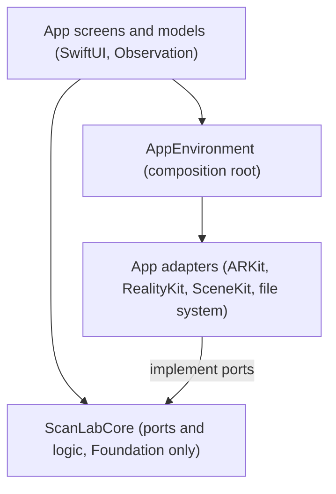

# LidarApp — Architecture

System overview for orientation. For coding rules see `docs/CONVENTIONS.md`; for why
things are this way see `docs/DECISIONS.md`.

The repository is **LidarApp**; the app it builds is **ScanLab** (GitHub
`NBS1997/ScanLab`, bundle ID `com.nbs1997.scanlab`, MIT licence, ADR-015). It is a
personal LiDAR scanning app for one iPhone 17 Pro Max. There is no server, no account and
no network code (ADR-001). This document describes the code on `main` after Bolts 1–8 and
the `fix-file-paths` fix.

**Stack:** Swift 6 language mode / SwiftUI, with the Observation framework for screen
state and Swift concurrency for background work. ARKit (depth, scene reconstruction),
RealityKit (sweep camera view, Object Capture), SceneKit (Explore camera view, scan
viewer), Model I/O (USDZ fallback only), OSLog. Minimum iOS 26.0, built with Xcode 26 on
GitHub's `macos-26` runner (ADR-002). No third-party code ships in the app (ADR-008).
**Entry point:** `App/Sources/ScanLabApp.swift` — `@main struct ScanLabApp` builds
`AppEnvironment.live()`, logs the launch, and shows `LibraryView`.

## System Layers

```
App screens and models  →  AppEnvironment (composition root)  →  App adapters
        │                                                              │
        └──────────────────────────→  ScanLabCore  ←───────────────────┘
                                 (ports and logic, Foundation only)
```



Text fallback: screens and their models use Core types and Core's ports; they get the
real implementations from `AppEnvironment`, which is the only place that names concrete
adapter types. Adapters implement Core's ports with Apple's sensor and file APIs. Core
depends on nothing but Foundation. All arrows point towards Core.

| Layer | Owns | May depend on | Must not depend on |
|---|---|---|---|
| ScanLabCore (`Packages/ScanLabCore`) | Geometry, simplification, file formats, scan library, capture rules, sensor maths, accuracy, log model, ports (protocols) | Foundation only | Any App code; ARKit, RealityKit, SceneKit, UIKit, SwiftUI, AVFoundation, Metal, Vision |
| App adapters (`FileLog`, `FileScanStore`, `LiveSensorFeed`, `ARKitSweepCapture`, `ObjectCapturePhotoCapture`, `BundledReference`, `CaliperStore`) | Translating platform APIs into Core types and errors | Core, Apple frameworks | Screens; making decisions (rules belong in Core) |
| App screens and models (`*View`, `*Model`, `ExportService`, `AccuracyService`) | What the owner sees and taps; running Core work off the main thread | Core, the port protocols, `AppEnvironment` | Concrete adapter types |
| Composition root (`AppEnvironment.swift`) | Creating the real adapters (`live()`) and preview fakes (`preview()`) | Everything above | — |

Boundary rules:

- **Core imports only Foundation** (ADR-003; stated in `Package.swift`). There is no
  automated check for this beyond the fact that Core must build and test on macOS with
  `swift test`; a reviewer checks imports.
- **Adapters translate, they do not decide.** State machines and rules live in Core
  (`CaptureSession`, `PhotoCaptureFlow`, `MeshAssembly`, `PhotoModelImport`), so they
  are tested in CI.
- **Screens see protocols, not adapters.** `AppEnvironment` exposes `any Logging`,
  `any LiveCameraFeeding`, `any LiveSweepCapturing`, `any PhotoCapturing`, and so on.
- **Everything is logged through the `Logging` port** (ADR-011). Console output is a
  SwiftLint error.

Known exception: the photo capture screen (`PhotoCaptureModel`, `PhotoCaptureView`)
holds Apple's `ObjectCaptureSession` directly, because `ObjectCaptureView` needs the
concrete session. The `PhotoCapturing` port covers support, permission and building only
(ADR-022).

## File Structure

```
App/
  Sources/
    ScanLabApp.swift      @main entry point; builds the environment and logs launch
    AppEnvironment.swift  composition root: live() and preview()
    Accuracy/             accuracy and reference-object screens and models,
                          AccuracyService, BundledReference, CaliperStore
    Capture/              New scan and sweep Capture screens, CaptureModel,
                          ARKitSweepCapture adapter and its LiveSweepCapturing port
      Photo/              photo capture screen and model, ObjectCapturePhotoCapture
                          adapter, raw-capture zip export
    Diagnostics/          FileLog: the file-backed Logging adapter
    Export/               ExportService: simplify, write temp file, save chooser
    Library/              FileScanStore adapter, LibraryModel, ScanDetailModel,
                          ModelView (SceneKit viewer)
    Screens/              Library, Scan detail, Explore, Export and Diagnostics views,
                          their models, CameraPreview (ARSCNView host)
    Sensors/              LiveSensorFeed adapter and the LiveCameraFeeding port
  Resources/              Assets.xcassets (app icon)
Packages/ScanLabCore/
  Package.swift           Foundation-only library; platforms iOS 18, macOS 15
  Sources/ScanLabCore/
    Accuracy/             reference model, STL reader, sampling, background removal,
                          alignment (ICP), deviation, report and reliability rule
    Build/                BuildInfo: version, build date, 90-day expiry
    Capture/              CaptureSession state machine, SweepCapturing port,
                          MeshAssembly, SweepCaptureService, CaptureText
      Photo/              PhotoCapturing port, PhotoCaptureFlow, PhotoModelImport,
                          raw-capture files, camera positions, build text
    Diagnostics/          LogEvent, Logging port, MemoryLog, LogCodec, LogTrimmer,
                          LogFormatter
    Files/                MeshFiles (STL and OBJ writers), OBJReader,
                          URL.fileSystemPath
    Geometry/             Vec3, Mesh, Transform, quadric simplifier, export detail
                          levels, y-up to z-up conversion, sample mesh
    Library/              Scan manifest, ScanStoring port, MemoryScanStore, ScanLibrary
                          actor, MeshBinary (SLMESH01), naming, thumbnails, viewer geometry
    Sensors/              DepthFrame, SensorFeeding port, colour maps, centre sampler,
                          frame-rate meter, overlays, close-range band, depth quality
    Units/                millimetre and metre display, storage sizes
  Tests/ScanLabCoreTests/ one flat folder of Swift Testing suites, plus fixtures
reference-object/         CadQuery script, pytest checks and committed outputs
                          (STL, STEP, feature table, measurement sheet) — ADR-010
scripts/check-coverage.sh Core line-coverage gate used by CI
.github/workflows/        ci.yml (checks), ios-build.yml (builder-managed),
                          reference-object.yml (generates the reference object)
project.yml               XcodeGen manifest; no .xcodeproj is committed (ADR-004)
builder.json              configuration for the builder delivery tool (ADR-016)
docs/                     guideline docs; checklists/ holds on-device checklists
aidlc-docs/               AI-DLC artefacts (requirements, design, Bolt records)
```

The App folders are grouped by feature, not strictly by layer: `Accuracy/`, `Capture/`
and `Library/` each mix screens, models and adapters, while `Screens/` holds the views
from the earliest Bolts. Find an adapter by its port, not by its folder.

## Key Modules

| Module | Responsibility | Notes |
|---|---|---|
| Diagnostics (`Core/Diagnostics`, `App/Diagnostics/FileLog.swift`) | One JSON line per event in `Application Support/Logs/scanlab.log`, mirrored to OSLog | `FileLog.log` queues the event on an `AsyncStream` and returns at once; one background consumer writes in order and flushes each event. Trimmed to 5,000 lines at launch. Undecodable lines are counted, not fatal. The Diagnostics screen reads and exports the same file |
| Geometry and export (`Core/Geometry`, `Core/Files`, `App/Export`) | `Mesh` in metres; quadric-error simplification; binary STL and OBJ in millimetres | Detail levels: Full, Fusion-friendly (≤ 10,000 faces), Light (≤ 5,000). `ExportService` simplifies off the main thread, checks free space, writes a temporary file, then hands it to `UIDocumentPickerViewController` in copy mode |
| Library (`Core/Library`, `App/Library/FileScanStore.swift`) | Saved scans; `ScanLibrary` actor is the single owner and writer | One folder per scan in `Application Support/Scans/<uuid>/`: `manifest.json`, `mesh.slmesh` (SLMESH01, ADR-019), `thumbnail.png` (160 × 160), optional `accuracy-report.json` and `RawCapture/`. New scans are written to a hidden `.incoming-…` folder and renamed into place |
| Sensors / Explore (`Core/Sensors`, `App/Sensors`, `App/Screens/Explore*`) | Live camera, depth and confidence overlays, centre distance, frame rate, close-range band | `LiveSensorFeed` runs an `ARSession` with `.sceneDepth` and copies 256 × 192 depth buffers into Core `DepthFrame`s. Camera drawn by `ARSCNView`; overlays coloured and rotated in Core (ADR-017). Edges toggle is disabled ("Coming in a later build") |
| Sweep capture (`Core/Capture`, `App/Capture`) | Moving-phone capture with ARKit scene reconstruction (ADR-005) | `ARKitSweepCapture` shows RealityKit `ARView` with scene understanding (ADR-018), keeps `ARMeshAnchor`s, and at Finish copies them into `MeshPart`s; Core `MeshAssembly` welds seams (0.5 mm). `SweepCaptureService` applies the session rules, converts to z-up and saves |
| Photo capture (`Core/Capture/Photo`, `App/Capture/Photo`) | Guided Object Capture and on-phone reconstruction (ADR-006) | `PhotogrammetrySession` at `.reduced` detail writes OBJ, read by Core's `OBJReader` via `PhotoModelImport` (ADR-022). Photographs and camera positions can be kept as the scan's raw capture and exported as a zip |
| Accuracy (`Core/Accuracy`, `App/Accuracy`) | Stage 1 of ADR-009: align a scan of the printed reference object and report surface error by size class | `AccuracyPipeline`: sample 20,000 points → remove background → align (36 guesses, trimmed point-to-plane ICP) → deviation → report with reliability rule (ADR-023, ADR-024). Reference STL and feature table bundled from `reference-object/output/`. Caliper values in `Application Support/Reference/caliper-values.json`. Feature fitting (stage 2) is not built yet |
| Units (`Core/Units`) | Display of lengths and storage | mm to 0.1 mm, metres at 1 m and over |
| Build info (`Core/Build`) | Version, build and TestFlight expiry | Build date comes from `SLBuildDate`, stamped into `Info.plist` by a post-build script in `project.yml` |

### Composition root

`App/Sources/AppEnvironment.swift` is a `Sendable` struct holding `log`, `buildInfo`,
`sensorFeed`, `library`, `reference`, `calipers`, `sweepCapture` and `photoCapture`, plus
a computed `accuracy` service. `live()` builds the real adapters; `preview()` builds an
in-memory log and library, a fixed build date and fake sensor and capture objects for
SwiftUI previews. Both are `@MainActor`, so `ScanLabApp` builds its environment in
`init()`. Add a new adapter here and nowhere else.

### Coordinates and units

- **Metres internally.** `Vec3` is three `Double`s in metres; `Mesh`, the stored
  SLMESH01 file, the accuracy code and the sensor code all use metres.
- **Millimetres in exports.** `MeshFiles` scales to millimetres when writing STL and OBJ.
  Accuracy reports present millimetres.
- **z-up everywhere it is stored.** The library, thumbnails, viewer, accuracy alignment
  and exports assume z points up (rule SL-13), which is what Fusion expects. ARKit and
  Object Capture produce y-up meshes; both capture paths call `Mesh.convertedFromYUp()`
  once, just before saving, which maps (x, y, z) to (x, −z, y) (ADR-025).

## Data Flow

**Sweep capture to saved scan**

```
CaptureView → CaptureModel.finish() → SweepCaptureService.finish()
  → LiveSweepCapturing.finish (ARKitSweepCapture: pause, copy anchors → MeshAssembly)
  → Mesh.convertedFromYUp() → ScanLibrary.add(mesh:method: .sweep)
  → FileScanStore.create (.incoming-… folder → rename) → log "library"
```

**Photo capture to saved scan**

```
PhotoCaptureView (ObjectCaptureView, ObjectCaptureSession in the model)
  → PhotoCapturing.build (ObjectCapturePhotoCapture: PhotogrammetrySession,
    .modelFile to a folder = OBJ at .reduced, plus .poses; USDZ + Model I/O fallback)
  → PhotoModelImport.mesh(from:) (OBJReader, weld, convertedFromYUp)
  → ScanLibrary.add(mesh:method: .photos) → optional keepRawCapture(_:from:)
```

**Accuracy check**

```
AccuracyView → AccuracyModel → AccuracyService.run(scanID:progress:)
  → ScanLibrary.mesh(for:) → AccuracyPipeline.run (SurfaceSampler → ScanIsolation
    → Alignment.align → Deviation.measure → AccuracyReporting.makeReport)
  → ScanLibrary.attachReport(_:to:) → FileScanStore.replaceReport
```

**Export**

```
ExportView → ExportModel → ExportService.prepareLevels (MeshSimplifier per level)
  → writeTemporaryFile (free-space check, MeshFiles STL/OBJ in mm)
  → UIDocumentPickerViewController (copy) → finish (temp file removed, logged)
```

## External Integrations

There are no network services. The integrations are Apple frameworks on the phone and
the delivery tooling on the owner's PC.

| Service | Used for | Failure behaviour |
|---|---|---|
| ARKit (`ARSession`, scene depth, scene reconstruction) | Explore live view, sweep capture | Unsupported device and camera-permission denial are checked first and shown as screen states; interruptions and tracking changes are logged and shown |
| RealityKit Object Capture (`ObjectCaptureSession`, `PhotogrammetrySession`) | Photo capture and reconstruction | OBJ request failure triggers one USDZ retry from the saved checkpoint, converted with Model I/O; the route used is logged. Errors map to `PhotoCaptureError` with plain-language text. An unfinished capture can be resumed from saved photographs |
| File system (Application Support) | Scans, log, caliper values, photo-capture folders | Typed `StoreError` / `MeshFileError`; storage-full is detected and reported; free space is checked before writes; damaged scan files are reported as corrupt, not loaded |
| Save chooser (`UIDocumentPickerViewController`, copy mode) | Exporting models, raw captures and the log | Cancel or failure is logged; the temporary file is removed |
| GitHub Actions (`ci.yml`) | All lint, format, test, coverage and compile checks | A failing step fails the run; nothing is delivered from CI |
| builder CLI and TestFlight (ADR-016) | Signed build, upload and TestFlight delivery from the PC | Depends on the PC and the builder tool; builds expire after 90 days, shown on the Diagnostics screen |

## Delivery

There is no Mac and no local Swift toolchain. Every check runs on GitHub's macOS runner
(`.github/workflows/ci.yml`) on every push and pull request: signing-material check,
SwiftLint, swift-format, Core tests with coverage, the 80% coverage gate, and an unsigned
device compile after `xcodegen generate`. After a Bolt is squash-merged to `main`,
delivery is `builder ios release --profile store` from the Windows PC, which builds a
signed snapshot through the builder-managed `ios-build.yml`, uploads it and adds it to
the internal TestFlight group (ADR-016). Signing material lives in
`C:\Users\natys\.scanlab-signing` and the repository's secret store, never in git.

## Areas of Extra Caution

- **File paths** — never pass `url.path()` to `FileManager`; it escapes the space in
  "Application Support" as `%20`, so every existence check fails. This broke build 4.
  Use `url.fileSystemPath` (ADR-021; SwiftLint rule `no_escaped_file_path`).
- **Axis conversion** — call `convertedFromYUp()` exactly once, just before saving a
  captured mesh. Converting twice, or not at all, puts scans on their side in the
  library and breaks accuracy alignment, which assumes z-up. Bundled reference data and
  exports are already z-up.
- **SLMESH01 layout** — `MeshBinary` is the on-phone format of every saved scan. Changing
  it without a new magic string and a reader for the old one makes existing scans read
  as corrupt (ADR-019).
- **Mesh simplifier performance** — the edge-length tie-break and the 24-neighbour cap
  in `MeshSimplifier` stop the algorithm going quadratic on flat areas. Removing either
  made the large-mesh test time out in CI (ADR-026).
- **Reliability thresholds** — the numbers in `ReliabilityRule` and `AlignmentSettings`
  are provisional (ADR-009, ADR-024) and the synthetic accuracy tests depend on them.
  Change them only with the owner's on-phone evidence, and re-run the tests.
- **Staged scan writes** — `FileScanStore` relies on a same-volume rename to make a new
  scan appear in one step. Writing straight into the scan's folder would let a crash
  leave a half-written scan. Crash safety was reasoned, not tested by killing the app.
- **Sensor code cannot be tested in CI** — adapters in `App/Sources` compile in CI but
  never run there. Keep them thin, log every notable step, and add items to the Bolt's
  on-device checklist in `docs/checklists/`.
- **`ios-build.yml`** is managed by `builder`; do not edit it by hand.
